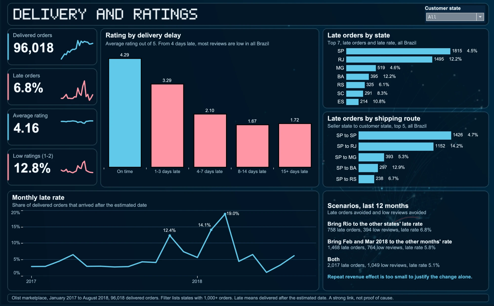

# Delivery Performance and Customer Satisfaction

## Summary

Late delivery is strongly linked to lower customer ratings on the Olist marketplace. A late order scores about 2 points lower out of 5, after accounting for region, category, month, price and freight. Half of all late orders are in two Brazilian states, São Paulo and Rio de Janeiro.

The business case for fixing delays is customer satisfaction. Direct revenue from repeat purchases is too small to justify the work alone.

## Question

Where are delivery delays concentrated, how much do they lower customer satisfaction, and which improvements would have the largest effect?

## Key Results

| Delivery | Average rating | Low ratings (1-2) |
| --- | --- | --- |
| On time or early | 4.29 | 9.2% |
| 1-3 days late | 3.29 | 32.2% |
| 4-7 days late | 2.10 | 67.6% |
| 8-14 days late | 1.67 | 80.2% |
| 15 or more days late | 1.72 | 78.3% |

- 6.8% of 96,018 delivered orders arrived late, worth R$985K of R$13.16M in product sales.
- São Paulo and Rio de Janeiro made up 50.7% of late orders.
- Rio had a 12.2% late rate against 4.5% in São Paulo. The São Paulo to Rio route alone had 1,152 late orders.
- The worst months were March 2018 (19.0%) and February 2018 (14.1%).

## Effect of Delay

| Comparison | Change in rating | 95% interval |
| --- | --- | --- |
| Simple comparison | -2.02 | -2.07 to -1.97 |
| With controls | -1.96 | -2.01 to -1.91 |
| Orders from the same seller | -1.92 | -1.97 to -1.87 |
| Reviews written after delivery only | -0.74 | -0.82 to -0.67 |

The last row is a conservative lower bound. Most angry reviews of late orders were written before the order arrived.

This is observational data, not an experiment, so the results show a strong link and do not prove cause.

## Predicting Late Orders

The model used only facts known at purchase. It was trained on 2017 and tested on January to August 2018.

| Method | PR-AUC | Precision in top 10% | Late orders caught in top 10% |
| --- | --- | --- | --- |
| No model | 0.077 | 7.7% | 10.0% |
| Gradient boosting | 0.135 | 16.4% | 21.1% |

The model is better than chance but too weak to run operations alone. It missed the size of the February and March 2018 waves, which suggests that most delays come from events after purchase.

## Scenarios

Based on the last 12 full months (74,040 orders, 7.8% late).

| Scenario | Late orders avoided | Late rate | Low reviews avoided | Repeat revenue per year |
| --- | --- | --- | --- | --- |
| Rio matches the other states | 758 | 6.8% | 394 | R$0 to R$956 |
| February and March match other months | 1,468 | 5.8% | 764 | R$0 to R$1,851 |
| Both | 2,017 | 5.1% | 1,049 | R$0 to R$2,543 |

Assumptions:

- Low reviews avoided use the +52 point effect on low ratings from the model with controls.
- Repeat revenue uses the change in 180-day repeat purchases after a late first order: -0.36 points, with a 95% interval of -0.92 to +0.20. This effect is not clear, so the range starts at zero.
- The revenue range uses the average order value of R$137.

## Recommendation

1. Start with the São Paulo to Rio route, since it is the largest single source of late orders.
2. Prepare extra capacity for peak periods, and track orders in transit, because purchase data cannot predict the large waves.
3. Test the change on part of the route first and compare ratings before rolling it out.
4. Measure success by late rate and low ratings, not by repeat revenue.

## Data

[Brazilian E-Commerce Public Dataset by Olist](https://www.kaggle.com/datasets/olistbr/brazilian-ecommerce), CC BY-NC-SA 4.0. The original files are not stored here because of their size.

- Period studied: January 2017 to August 2018. Months before and after have very few orders.
- Only 3% of customers bought more than once.
- Reviews written before delivery are kept, because 96% of them belong to late orders.
- A late order is one delivered after the estimated delivery date.

## Steps

1. `sql/load_data.py` loads the CSV files into SQLite.
2. `sql/analysis.sql` cleans and joins the tables. `sql/run_analysis.py` writes the results to `output/`.
3. `python/delivery_effect.py` estimates the effect of delay.
4. `python/late_model.py` trains and tests the model.
5. `python/scenarios.py` runs the repeat purchase check and the scenarios.
6. `dashboard/olist_delivery_dashboard.twbx` is the Tableau dashboard. Its background map is drawn from the dataset's customer locations and shipping routes.

To run: put the Kaggle CSV files in `raw/`, then `python3 sql/load_data.py raw olist.db`, `python3 sql/run_analysis.py olist.db sql/analysis.sql output`, and each script in `python/` with `olist.db output`.

## Tools

SQL (SQLite), Python (Pandas, Statsmodels, Scikit-learn), Tableau
